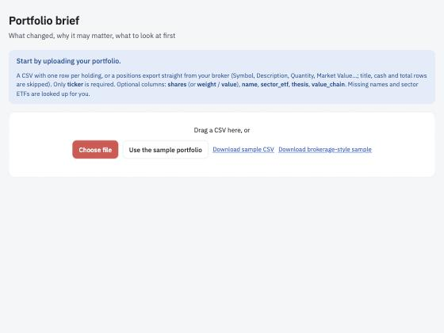
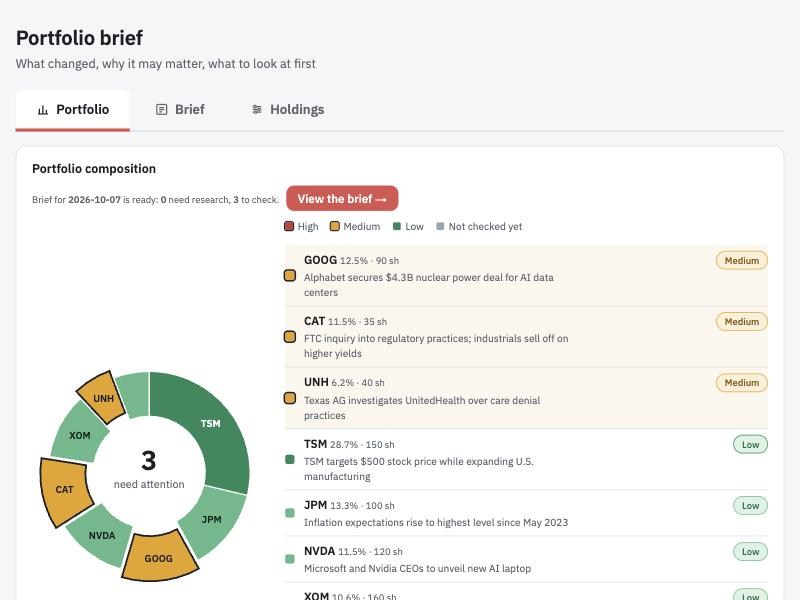
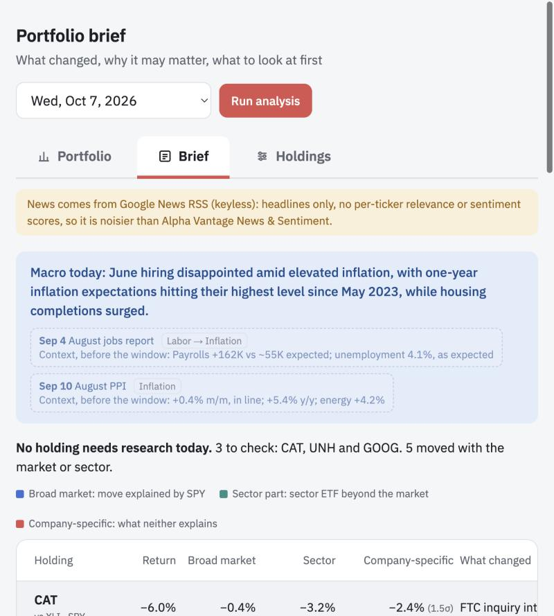
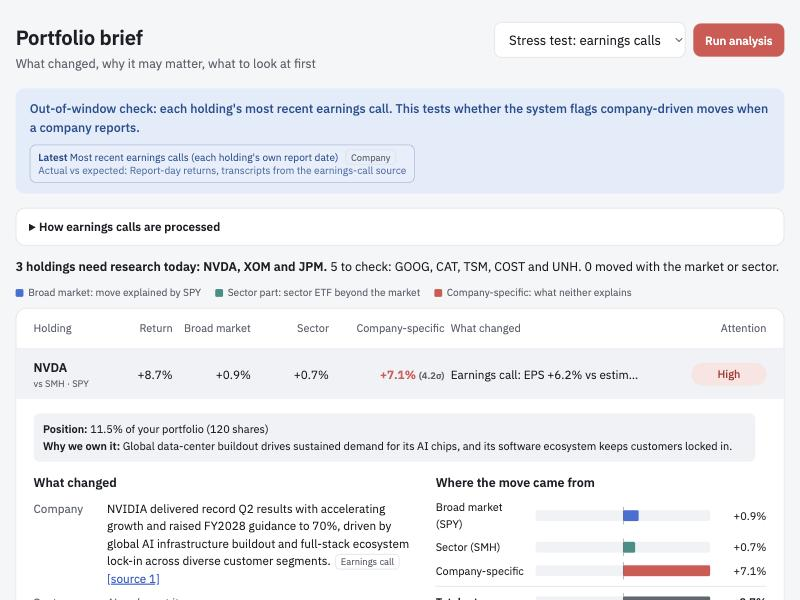
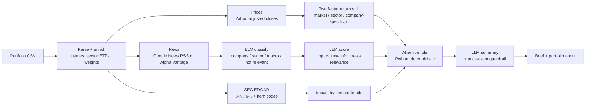

# Sharpe

**An AI portfolio monitoring agent.** Upload your holdings and Sharpe tells you *what changed*, *why it may matter*, and *which positions deserve a closer look first*. It separates a stock's move into the part explained by the broad market, the part explained by its sector, and the part that is specific to the company. It then reads the day's news, SEC filings and earnings calls to decide whether that company-specific part has a real, new, high-impact explanation.

> "Sharpe" is just the name of the tool. The core of the product is the monitoring brief; the portfolio optimizer is a small optional extra.

Built for the *AI Methods* final project at Carnegie Mellon Tepper (team: Evelyn Chen, Yamini Joshi, Roma Chandiran, Prajju Mantha). It started as a Colab pipeline (data pipeline + LLM pipeline) and is now a local web app.

**Sharpe produces research priority, not buy/sell recommendations.**

---

## Contents

1. [Screenshots](#screenshots)
2. [The question it answers](#the-question-it-answers)
3. [Quick start](#quick-start)
4. [Configuration and API keys](#configuration-and-api-keys)
5. [Using the app](#using-the-app)
6. [How it works](#how-it-works)
7. [Project layout](#project-layout)
8. [API reference](#api-reference)
9. [Input formats](#input-formats)
10. [Data sources and rate limits](#data-sources-and-rate-limits)
11. [Design decisions](#design-decisions)
12. [Known limitations](#known-limitations)
13. [Security and privacy](#security-and-privacy)
14. [Troubleshooting](#troubleshooting)
15. [Roadmap](#roadmap)

---

## Screenshots

| Upload | Portfolio (composition + attention) |
|---|---|
|  |  |

| Brief | Earnings-call stress test |
|---|---|
|  |  |

---

## The question it answers

> *Was a stock's move driven by the broad market or its sector, or by something specific to the company?*

Investors who do not trade every short-term move still have to decide, every day, which holdings deserve research time. Reading every headline is slow and noisy. Sharpe combines **price decomposition** (is today's move unusual for this stock?) with **LLM-scored information** (is there new, high-impact company news that explains it, and does it touch *our reason for owning the stock*?) to rank holdings as **High / Medium / Low** attention.

---

## Quick start

Requirements: Python 3.9+ and a browser. No database or build step.

```bash
git clone <your-repo-url> sharpe
cd sharpe

python3 -m venv .venv
source .venv/bin/activate          # Windows: .venv\Scripts\activate
pip install -r requirements.txt

cp .env.example .env               # then edit .env and add your keys (see below)
python app.py
```

Open **http://127.0.0.1:5057**. To use a different port: `PORT=8000 python app.py`.

Try it without your own data: on the first screen click **Use the sample portfolio**, or upload `sample_portfolio.csv` / `sample_brokerage_export.csv` from this repo.

The app works with **no keys at all** (prices, return split, SEC filings and the portfolio overview are keyless); keys unlock news scoring and summaries. See the table below.

---

## Configuration and API keys

Copy `.env.example` to `.env`. Every key is optional; a missing key disables only the step that needs it, and the app tells you on screen.

| Variable | Needed for | Notes |
|---|---|---|
| `OPENROUTER_API_KEY` **or** `ANTHROPIC_API_KEY` | Classifying and scoring news, writing summaries, earnings-call analysis | OpenRouter is checked first. |
| `SHARPE_MODEL` | Choosing the model | Default `anthropic/claude-haiku-4.5` (OpenRouter) or `claude-haiku-4-5-20251001` (Anthropic). |
| `ALPHAVANTAGE_API_KEY` | Earnings reports and call transcripts (free tier works); better news if the key is premium | Free tier: 25 calls/day, 5/min. |
| `SEC_EMAIL` | SEC EDGAR | EDGAR asks for a contact address in the User-Agent. |
| `AV_PAUSE` | Pacing | Seconds between uncached Alpha Vantage calls (default `12`). |
| `PORT` | Server port | Default `5057`. |

What works without each key:

| Missing | What happens |
|---|---|
| Alpha Vantage key | News falls back to Google News RSS; the earnings stress test is unavailable. |
| LLM key | Return split, filings and portfolio overview still work; articles are not classified or summarized. |
| Both | Return split, SEC filings, portfolio overview and the what-if tool. |

**Never commit `.env`.** It is already in `.gitignore`.

---

## Using the app

The app **always opens on the upload page**.

1. **Upload a portfolio** (CSV, drag-and-drop, or *Use the sample portfolio*). See [Input formats](#input-formats). You review the parsed holdings and any warnings, then click **Confirm and start**.
2. **Portfolio tab** (opens first). A color-coded donut chart shows your composition and pulls out the holdings that need attention. Underneath: performance vs SPY, volatility, beta, a plain-language "what stands out" list, a positions table with each holding's share of risk, and a collapsed optional what-if optimizer. While you look at this tab, Sharpe is already building the latest day's brief in the background; a **View the brief →** button appears when it is ready.
3. **Brief tab.** Pick a trading day and click **Run analysis** (or use the one built for you). Holdings are ranked High, Medium, Low. Click a row to expand it: why you own it, what changed (company / sector / macro layers with source links), where the move came from (market / sector / company-specific bars), the four score tiles, and sources.
4. **Stress test.** In the day menu choose **Stress test: earnings calls** to check how each holding's most recent earnings call (guidance, EPS surprise, tone) scored on its report-day move.
5. **Holdings tab.** Edit tickers, sector ETFs, names, each holding's thesis ("why we own it") and value chain. The thesis and value chain feed the LLM scorer, so better theses give better relevance scores.

The tabs are keyboard accessible (Left/Right/Home/End) and labelled for screen readers.

---

## How it works



### 1. Return split (Python, deterministic)

For each holding and day, Sharpe fits on the 120 trading days **before** that day:

```
stock return = α + β₁·SPY + β₂·(sector ETF − SPY) + residual
```

* **Broad market part** = β₁ × SPY return
* **Sector part** = β₂ × (sector ETF − SPY)
* **Company-specific part** = total − market − sector (α stays in this part)
* **σ** = standard deviation of the residuals; **z** = company-specific part ÷ σ. A move with |z| ≥ 2 is "unusual for this stock".

About 1 in 20 ordinary days crosses 2σ by chance, so some flags are noise. Large holdings inside their own sector ETF (e.g. NVDA and TSM in SMH) leak some of their move into the sector part, so the company-specific part can be understated; the app says so on those cards.

### 2. Information layers

News is time-aligned to U.S. trading days: before 4:00 pm ET counts for that day, at or after 4:00 pm for the next. Each article is classified **for each holding** as:

* **company**: about the holding itself (results, guidance, deals, actions against it, analyst ratings *on* it)
* **sector**: its industry or value chain (a customer, supplier, key input); tagged *value chain* where relevant
* **macro**: CPI, jobs, Fed, retail sales, energy and geopolitical shocks (with a channel tag)
* **not relevant**: passing mentions, stock lists, and the holding acting as analyst/underwriter on *another* company

Each relevant item is then scored 1–3 for **impact**, **new information** and **thesis relevance** against a written rubric. SEC filings skip the LLM for impact: item codes set it by rule (2.02/1.01/2.01 → 3, 7.01/8.01 → 2, 5.07 → 1; 5.02 depends on role).

### 3. Attention rule (Python, not the LLM)

| Company-specific move | Company news | Attention |
|---|---|---|
| ≥ 2σ | impact ≥ 2 **and** new info ≥ 2 | **High** |
| ≥ 2σ | low-impact / not new, or none found | **Medium** |
| < 2σ | impact 3 | **Medium** (news the market has not reacted to) |
| < 2σ | otherwise | **Low** |

Holdings are sorted High → Medium → Low, ties broken by thesis relevance, then size of σ. Keeping this step in plain Python makes it auditable and identical to the team's written rule.

### 4. Summaries and the guardrail

The LLM writes a headline, one line per layer, and a two-sentence "why it may matter". It is **not told the price move**, and a regex guardrail rejects any summary that describes the stock's price or links a news item to it (one retry, then it falls back to the article title). The product explains *information*, not *causes of price moves*.

### 5. Earnings-call stress test

Because no earnings fall in many windows, the stress test takes each holding's most recent report, finds its reaction day (after-close reports map to the next trading day), retrieves guidance/outlook passages from the transcript (retrieve-then-extract), and extracts guidance, tone, key metrics, and the top analyst theme. Impact: guidance raised/cut or |EPS surprise| ≥ 5% → 3; guidance maintained with a tone shift → 2; otherwise 1.

### 6. Portfolio tab

The donut is colored by attention (red High, amber Medium, green Low, gray not checked), with flagged slices pulled out and outlined so color is never the only signal. Before the brief finishes, only large unexplained price moves (≥ 2σ) are highlighted. The overview also reports performance vs SPY, volatility, worst drawdown, beta, each position's share of portfolio risk, and the most correlated pair. A collapsed what-if section back-tests alternative weightings (including a max-Sharpe-ratio mix) against your current weights; it is exploratory.

---

## Project layout

```
.
├── app.py                      # Flask server and JSON API
├── core.py                     # All logic: prices, return split, news, SEC, LLM, attention rule, earnings, overview, optimizer, CSV parsing
├── templates/index.html        # Single-page UI (HTML + CSS + vanilla JS, no build step)
├── holdings.default.json       # Default theses, value chains, macro calendar (Sep 11–17, 2026) and context events
├── sample_portfolio.csv        # Mock portfolio (8 stocks) for testing
├── sample_brokerage_export.csv # Mock broker "positions" export (title lines, cash and total rows, money-market fund)
├── requirements.txt
├── .env.example
└── docs/screenshots/
```

Runtime files (git-ignored): `.env`, `holdings.json` (your confirmed portfolio), `cache/` (API and LLM responses).

---

## API reference

All endpoints are local; there is no authentication (see [Security](#security-and-privacy)).

| Method | Path | Purpose |
|---|---|---|
| GET | `/` | The UI |
| GET | `/api/config` | Current holdings and which keys are configured |
| POST | `/api/config` | Save holdings (`{market, holdings:[…]}`) |
| POST | `/api/upload` | Parse a CSV (multipart `file` or JSON `{csv}`); returns holdings and warnings, saves nothing |
| GET | `/sample.csv`, `/sample_brokerage.csv` | Sample files |
| GET | `/api/days` | Last ~60 trading days available |
| POST | `/api/analyze` | Start a brief: `{day: "YYYY-MM-DD"}` or `{day: "earnings"}`; returns a job id |
| GET | `/api/job/<id>` | Job status, progress, log, and result |
| GET | `/api/overview` | Portfolio overview data |
| POST | `/api/optimize` | What-if optimizer: `{lo, hi, rf, holdout}` |

---

## Input formats

Only a **ticker** column is required. Recognized columns (case-insensitive, extra columns ignored):

| Meaning | Accepted names |
|---|---|
| Ticker | `ticker`, `symbol` |
| Position size | `shares` / `quantity` / `qty`, or `weight` / `allocation`, or `value` / `market_value` |
| Name | `name`, `company`, `description` |
| Sector benchmark | `sector_etf`, `etf`, `benchmark` |
| Thesis | `thesis`, `why`, `reason` |
| Value chain | `value_chain`, `chain`, `notes` |

Weights come from `weight`, else `value`, else shares × latest price, else equal weight. Missing names and sector ETFs are looked up (Yahoo search, plus a small built-in map). When a sector cannot be found the holding is benchmarked against SPY and you are warned.

**Broker exports work as-is** (Schwab-style positions files): title lines are skipped; cash, account total, short, and money-market rows are left out with a note; `$`, `%`, commas and `(negative)` values parse correctly. Up to 15 holdings are analysed (news and LLM cost grow per holding).

---

## Data sources and rate limits

| Data | Source | Key | Notes |
|---|---|---|---|
| Prices (adjusted) | Yahoo Finance chart endpoint | none | Unofficial; may throttle heavy use |
| News | Google News RSS (fallback) or Alpha Vantage `NEWS_SENTIMENT` | none / AV | AV news is premium on many keys; Sharpe detects that and remembers it |
| SEC filings | SEC EDGAR (`data.sec.gov`) | none (needs contact email) | 8-K and 6-K with item codes |
| Earnings, transcripts, calendar | Alpha Vantage | AV (free OK) | ~2 calls per holding; paced at 12 s |
| LLM | OpenRouter or Anthropic | yes | Temperature 0, JSON output, cached |

Everything is cached under `cache/` (including LLM answers keyed by model and prompt), so re-running a day costs nothing after the first time.

---

## Design decisions

* **Attention is a rule, not a vibe.** The LLM reads text and scores it against a rubric; Python decides High/Medium/Low. This is testable and matches the written spec.
* **No price talk from the model.** Summaries are generated without the price move and checked by a guardrail.
* **Research priority, not recommendations.** The UI repeats this where flags are shown.
* **Graceful degradation.** Every external dependency has a fallback or a clear message; nothing silently shows "Low".
* **Frozen theses.** The thesis is what makes "relevance" meaningful. Write it *before* looking at the day's news (the original project did this to reduce labeling bias).
* **No build step.** One HTML file, one Python module, easy to read in a code review.

---

## Known limitations

* **Keyless news is noisy.** Google News gives headlines only, with no per-ticker relevance or sentiment, so some items are mis-layered (e.g. a Fed story filed as company news). Premium Alpha Vantage news is better.
* **"Macro today" for uncovered days** is LLM-written from headlines and can pick up stale stories. The built-in macro calendar covers only Sep 11–17, 2026 (the original project window).
* **Single shared state.** The confirmed portfolio is saved server-side in one `holdings.json`; the app is built for one user at a time on a local machine.
* **Short windows.** The regression uses 120 days; the 2σ threshold produces some false flags by design.
* **Sector leakage** for stocks that dominate their own sector ETF (NVDA/TSM in SMH).
* **Free-tier limits.** Alpha Vantage allows 25 calls/day, so the earnings stress test on a large portfolio can take several minutes and may need to be spread across days.
* **The what-if optimizer** uses historical means and a short hold-out; its in-sample Sharpe ratios overstate what to expect.

---

## Security and privacy

* The server has **no authentication** and binds to `127.0.0.1`. Do not expose it to the internet as is: anyone with access could spend your API credits. If you deploy it, add authentication and per-user storage first.
* Your portfolio and uploaded files stay on your machine, except that ticker symbols and article text are sent to the data and LLM providers to do the analysis.
* API keys live only in `.env` or environment variables. If a key was ever pasted into a chat, issue, or commit, revoke and reissue it.

---

## Troubleshooting

| Symptom | Fix |
|---|---|
| `Address already in use` | Another copy is running: stop it, or use `PORT=8000 python app.py`. |
| "NEWS_SENTIMENT is a premium endpoint" | Your Alpha Vantage key is free tier. The app falls back to Google News automatically; delete `cache/av_news_blocked` after switching to a premium key. |
| Everything shows Low with no news | Check the status chips at the bottom: LLM key missing, or news fetch failed (see the yellow notices). |
| Upload says "No ticker column" | Rename a column to `ticker` or `symbol`. |
| A ticker is skipped | Yahoo has no price history for it (money-market fund, option, delisted symbol). |
| Slow first run | The first run of each day fetches news and calls the LLM; later runs are cached. |
| Alpha Vantage "rate limit" messages | Free tier is 5 calls/min and 25/day; wait, or raise `AV_PAUSE`. |

---

## Roadmap

* Per-user sessions and authentication so a team can share one deployed instance
* Premium news source (Alpha Vantage premium or Finnhub backup) for per-ticker relevance
* Peer-basket benchmarks (e.g. NVDA vs AMD, AVGO; JPM vs BAC, WFC, C) to fix sector leakage
* Longer history to calibrate the 2σ threshold; extend windows into earnings season
* Retrieval over 10-K/10-Q risk-factor changes
* Human-labeled evaluation set: accuracy, Cohen's κ, time saved vs manual monitoring

---

*Sharpe is a research tool for educational use. Nothing here is investment advice.*
